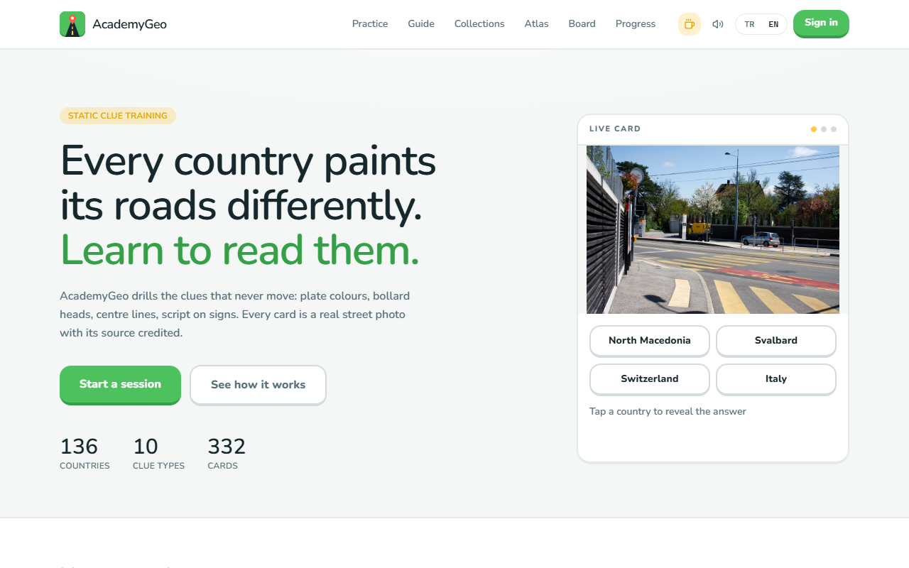
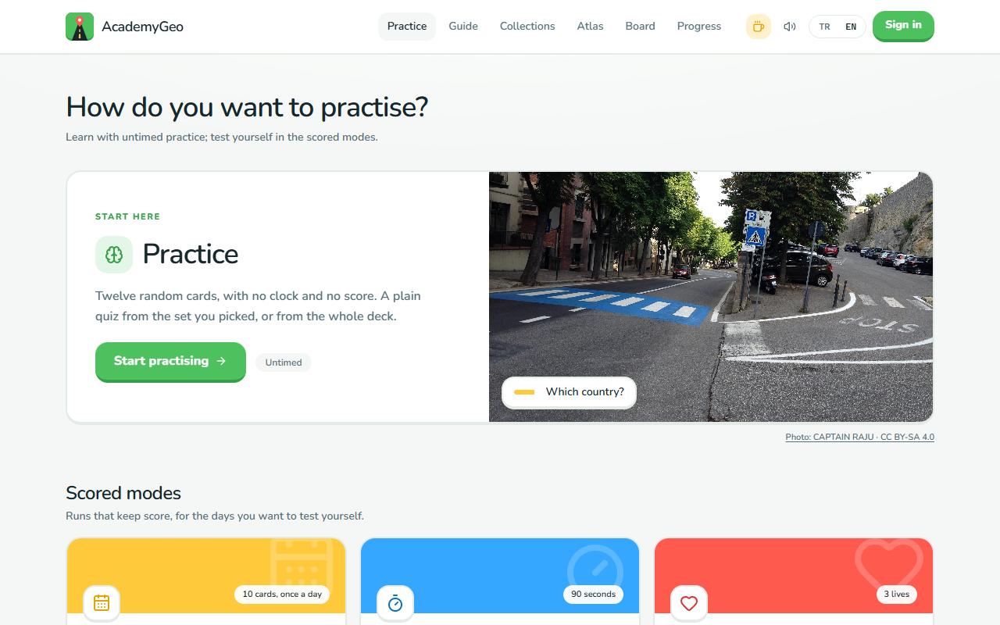
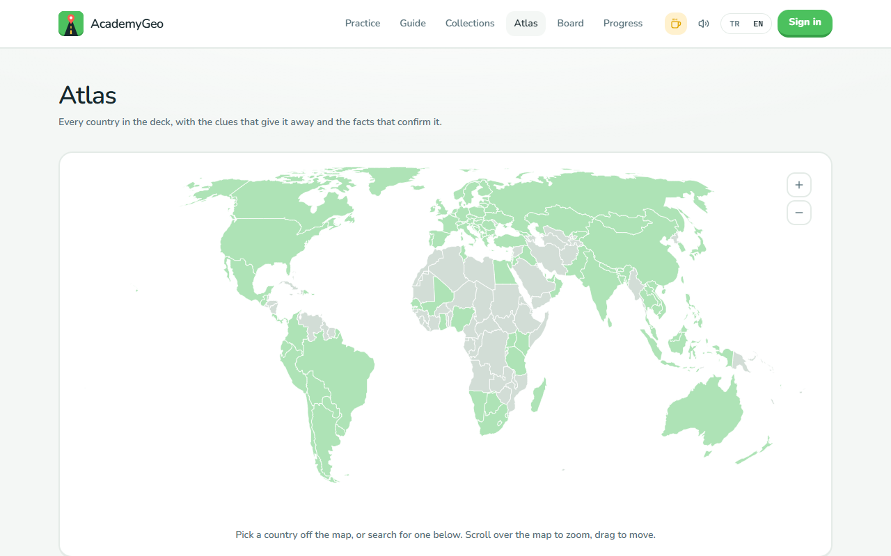
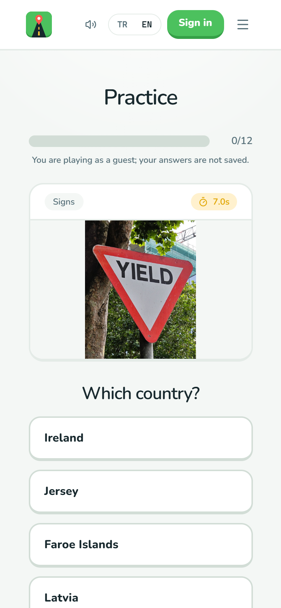
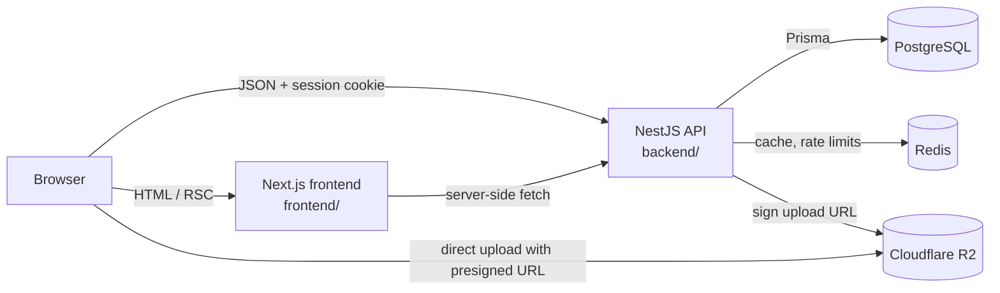

# AcademyGeo

A bilingual (Turkish / English) web app that trains GeoGuessr players to recognise a country from roadside clues (number plates, bollards, road lines, signs, script, vegetation) using real street photos and a spaced repetition schedule.

**Live:** [academygeo.com](https://academygeo.com) (Turkish) · [academygeo.com/en](https://academygeo.com/en) (English). Practice works without an account.

Designed, built and deployed by Hasan Süzen as a one-person project: product, UI, frontend, backend and hosting.

| Landing page | Game modes |
| --- | --- |
|  |  |
| **Atlas (server-rendered SVG world map)** | **Practice on a phone (390 px)** |
|  |  |

<sub>Card photos are third-party images (mostly Creative Commons) stored in object storage, not in this repository. The site credits each one next to the answer.</sub>

## Features

- **Practice** with a spaced repetition schedule: cards a player misses come back sooner, cards they know move days or weeks out.
- **Six scored modes** on top of practice: daily challenge (same hand for everyone, seeded from the UTC date), 90-second rush, three-lives survival, duel (the two countries this player confuses most), flash (the photo is hidden before answering) and a "weak spots" drill.
- **Leaderboards** (site-wide by experience, plus per mode, all-time and weekly), levels and achievement badges.
- **Atlas** of every country in the deck: facts, coverage notes and every published clue photo, grouped by clue type.
- **Guides and blog** written in a rich text editor (Tiptap), sanitised on the server before storage.
- **Admin panel**: cards, collections, countries, guides, posts, pages, SEO settings, user management (promote, suspend, sign out everywhere, delete) and an audit log of admin changes.
- **SEO**: per-page metadata, JSON-LD, `sitemap.xml` and `robots.txt` generated per request; crawlers are blocked outside production.
- **Google sign-in** only. Players can delete their own account from the profile page.

## Tech stack

Taken from the `package.json` files and imports in this repository.

| Layer | Technology |
| --- | --- |
| Frontend | Next.js 16 (App Router, server components), React 19, TypeScript, Tailwind CSS 4, Framer Motion, next-intl, Tiptap, lucide-react |
| Backend | NestJS 12, TypeScript, Prisma 7 (`@prisma/adapter-pg`), class-validator, helmet, sanitize-html |
| Auth | Better Auth (Google OAuth, database sessions) |
| Data | PostgreSQL 17, Redis 7 (ioredis) |
| Storage | Cloudflare R2 through the AWS S3 SDK (presigned uploads) |
| Testing | Vitest (both apps), Supertest, Nest testing module |
| Tooling | npm workspaces, oxlint (backend), ESLint (frontend), Prettier |
| Deployment | Docker multi-stage builds (Node 24 Alpine, non-root user, health checks), Docker Compose locally, Coolify in production |

## Architecture



- **frontend/** renders pages on the server and calls the API from both the server and the browser. A proxy (`frontend/src/proxy.ts`) picks `/tr` or `/en` from the visitor's country header or a saved cookie.
- **backend/** is a NestJS app with one module per area: `review`, `games`, `progress`, `stats`, `atlas`, `decks`, `guides`, `content`, `admin`, `auth`, `storage`, `supporters`, `health`. All routes sit under `/api`, and every request body goes through a global `ValidationPipe` with whitelisting.
- **PostgreSQL** holds 19 Prisma models (users and sessions, cards, decks, review state, game runs, achievements, posts, guides, SEO settings, audit log). The schema is in `backend/prisma/schema.prisma`.
- **Redis** caches leaderboards, per-user dashboard stats and the supporters list, and backs a small fixed-window rate limiter (`backend/src/common/rate-limit.guard.ts`) applied per route to the expensive ones: starting and answering runs, review answers, and signing uploads.

## Technical highlights

- **Spaced repetition engine** (`backend/src/review/srs.ts`): an SM-2 variant. Players do not rate their own recall; the grade comes from correctness and response time (under 2.5 s, under 8 s, slower). A miss brings the card back in 10 minutes and lowers its ease factor, which never drops below 1.3.
- **Scoring the client cannot fake** (`backend/src/games/`): the dealt hand is stored on the `GameRun` row, so the browser never sees upcoming cards. The answer time the client reports is capped by the server's own `servedAt` timestamp, so a doctored clock cannot earn a speed bonus. Scoring is a pure function (`scoring.ts`) with its own tests.
- **Wrong options that teach something** (`backend/src/review/choices.ts`): the three wrong answers come from the correct country's region first, so players learn to tell Turkey from Georgia, not from Brazil.
- **Deterministic daily challenge** (`backend/src/games/daily.ts`): the UTC date is hashed (FNV-1a) into a seeded shuffle, so every player gets the same hand without writing a row first.
- **World map without a map service**: Natural Earth shapes (`world-atlas`) are projected once at build time with d3-geo (`npm run map:build`) and rendered on the server as plain SVG paths, about 29 KB gzipped. No geometry library ships to the browser.
- **Sound effects with no audio files**: short note sequences in `frontend/src/lib/sound-design.ts` played through the Web Audio API.
- **Admin safety rules**: admins cannot suspend, demote or delete themselves, the last admin cannot be removed, and account actions and content edits are recorded in the audit log. Non-admins get a 404 for admin pages, and the API rejects their requests with a 403.
- **Uploads skip the API**: the backend only signs an R2 upload URL that expires after 10 minutes, and stored files get random UUID names so a filename cannot give the answer away.

## Tests

- **60 test files**: 37 backend unit test files, 20 frontend unit test files, and 3 backend end-to-end files that run against a real Postgres and Redis.
- The unit suites currently run **337 tests** (209 backend, 128 frontend), all passing.
- They cover the SRS scheduler, scoring, every game mode, leaderboards, levels and badges, rate limiting, auth wiring, HTML sanitising, SEO output, locale detection and map viewport maths.

```bash
npm test                                   # unit tests, both apps
npm run test:e2e --workspace backend       # needs Postgres + Redis running and a seeded database
npm run typecheck
npm run lint
```

## Running locally

Requirements: Node.js 20.11+ (the Dockerfiles use Node 24), Docker.

```bash
npm install

cp backend/.env.example backend/.env
cp frontend/.env.example frontend/.env.local
```

In `backend/.env`, set `BETTER_AUTH_SECRET` (for example `openssl rand -base64 32`), `GOOGLE_CLIENT_ID` and `GOOGLE_CLIENT_SECRET`. The API will not start until all three have a value. Any placeholder is enough to browse and practise as a guest; signing in needs real Google OAuth credentials with `http://localhost:3001/api/auth/callback/google` as a redirect URI. The R2 settings are optional: without them, uploads are turned off.

```bash
docker compose up -d postgres redis        # Postgres on 5433, Redis on 6380 (loopback only)
npm run db:push --workspace backend        # create the schema
npm run seed --workspace backend           # countries, starter cards (illustrations), pages, guides
npm run dev                                # API on :3001, web on :3000
```

Open http://localhost:3000. To make yourself an admin, add your Google email to `ADMIN_EMAILS` before your first sign-in, or run `npm run admin:grant --workspace backend -- you@example.com`.

The full stack also runs in Docker with `docker compose up --build`, which reads `backend/.env`.

## Repository layout

```
backend/              NestJS API
  prisma/             schema, seed data and scripts
  src/<module>/       one folder per feature module, with its *.spec.ts tests next to it
  test/               end-to-end tests
frontend/             Next.js app
  messages/           tr.json / en.json translations
  src/app/[locale]/   routes (play, atlas, guides, blog, leaderboard, profile, admin, ...)
  src/lib/            client and server helpers, with their tests
docker-compose.yml    local Postgres, Redis and both apps
```

Design notes written during development (game rules, the admin panel, seeding, deploying to Coolify) are in [README.old.md](README.old.md).

## About the author

**Hasan Süzen**, full stack developer based in Türkiye.

- LinkedIn: [linkedin.com/in/hasansuzen](https://www.linkedin.com/in/hasansuzen)
- Also built: [theorychess.com](https://theorychess.com)

AcademyGeo is an independent fan project. It is not affiliated with or endorsed by GeoGuessr AB.

No open source license is granted at this time; the code is published so it can be read and reviewed.
